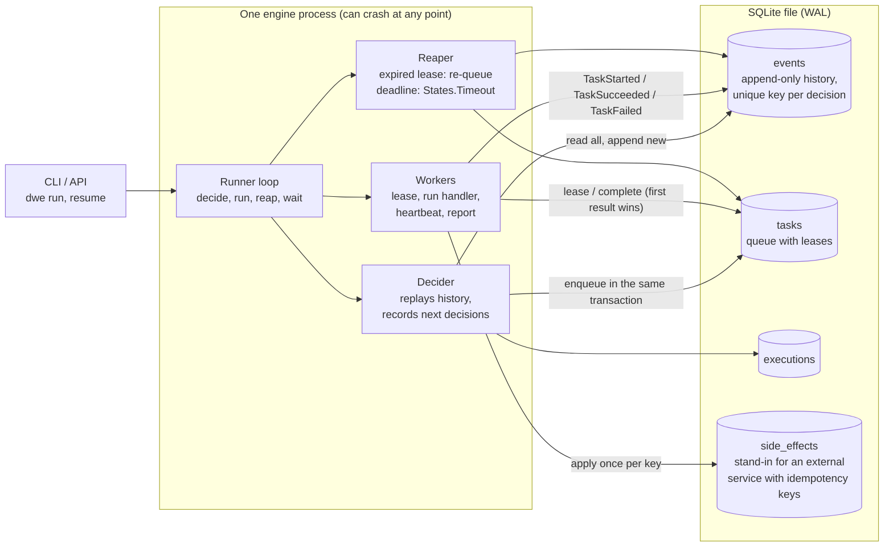
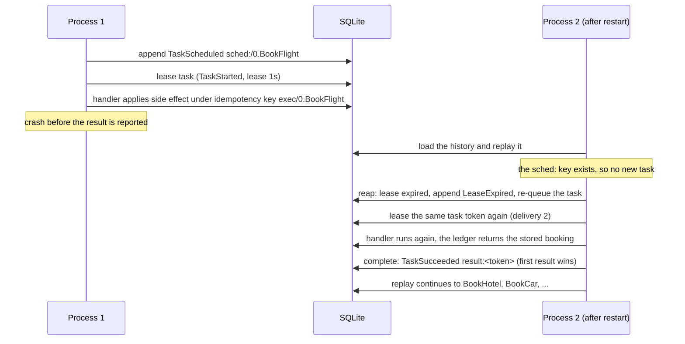

# durable-workflow-engine

A small durable workflow engine in plain Python 3.12. You write a workflow as a JSON state machine,
in the style of the Amazon States Language. The engine runs it, and it records every step in SQLite.
If the process dies at any point, a new process reads the history and continues from where the old one stopped.

No third-party packages. The runtime uses only the standard library. The tests use pytest.

## The problem

A long business process calls many services. Example: book a flight, a hotel, and a car.
Each call can fail, time out, or succeed after the caller dies. A plain script loses its place when it crashes.
Then it runs steps again or skips them. People get two bookings, or a booking that is never cancelled.

A durable workflow engine fixes this. It keeps the progress of each run outside the process.
It retries failed steps on a schedule. It runs undo steps when a later step fails.
It makes sure that a crash never makes a step take effect twice.

## What it supports

- **States:** `Task`, `Choice`, `Parallel`, `Map`, `Wait`, `Pass`, `Succeed`, `Fail`.
- **Retry per state:** `ErrorEquals`, `IntervalSeconds`, `BackoffRate`, `MaxAttempts`, `MaxDelaySeconds`, and
  `JitterStrategy: "FULL"`. Each retrier keeps its own count. The first retrier that matches the error wins.
- **Catch per state:** route an error to another state, and put the error object at `ResultPath`.
- **Error names:** your own names from `TaskError`, plus `States.ALL`, `States.TaskFailed`, `States.Timeout`,
  `States.Runtime`, `States.NoChoiceMatched`, and `States.ExceedToleratedFailureThreshold`.
- **Input and output processing:** `InputPath`, `Parameters`, `ResultSelector`, `ResultPath`, `OutputPath`,
  and `$$` context paths such as `$$.Map.Item.Index`.
- **Map:** `MaxConcurrency`, `ToleratedFailureCount`, `ToleratedFailurePercentage`, and `ItemSelector`.
  A failed item becomes `{"Error": ..., "Cause": ...}` in the output, so the next step can report it.
- **Durability:** an append-only event history, deterministic replay, and task tokens that make a result count once.
- **Workers:** a task queue with leases, heartbeats, re-dispatch when a lease expires, and a timeout per task.
- **Tools:** a CLI to run, resume, list, and inspect executions, and to kill the process at a chosen point.
  Metrics and a text timeline come from the history.

## Architecture



The **decider** is the core. It walks the state machine from `StartAt` each time it runs.
It gives every state visit a path, such as `/2.BookCar#1` (step 2, state `BookCar`, attempt 1)
or `/0.AnalyzeAll#1/i7/0.Analyze#2` (item 7 of a Map, second attempt).
Every decision gets a key built from that path: `sched:/2.BookCar#1`, `exit:/2.BookCar`, `item:/0.AnalyzeAll#1:7`.
Before it makes a decision, the decider looks for that key in the history.
If the key is there, it uses the recorded value. If not, it appends a new event.
So you can run a pass any number of times, and it always reaches the same result.

## Crash and resume



## Quickstart

```bash
python3.12 -m venv .venv && . .venv/bin/activate
pip install -e '.[dev]'
pytest -q

dwe run saga --input '{"trip_id": "T-1"}' --show
dwe run map_analysis --input '{"items": [{"id": 1}, {"id": 2, "corrupt": true}, {"id": 3}, {"id": 4}]}' --workers 4 --show
dwe run order --input '{"lines": [{"sku": "A", "qty": 3, "price": 400}], "email": "a@example.com", "card_failures": 2}' --show
dwe list
dwe history <execution-id>
dwe timeline <execution-id>
dwe metrics <execution-id> --json
```

Without an install, use `PYTHONPATH=src python3.12 -m dwe ...`.
`run` accepts a path to any JSON definition, or the name of an example in `src/dwe/examples/`.
`--activities some.module` loads your own handlers from a module that has a `REGISTRY`.

To write a handler:

```python
from dwe import Registry, TaskError

REGISTRY = Registry()

@REGISTRY.register("charge_card")
def charge_card(order, ctx):
    if ctx.attempt == 1:
        raise TaskError("Transient", "gateway returned 503")   # Retry and Catch match on "Transient"
    return ctx.effect(lambda: {"charged": order["total"]})     # at most once per idempotency key
```

## Demo output

These are real runs from this repository. IDs and times change from run to run.

**1. Kill the process after a booking is made but before the result is reported, then resume.**

```text
$ dwe run saga --input '{"trip_id": "T-42", "fail_at": "car"}' --crash-on worker:before_report --lease 1
started fda7a5808fff
execution fda7a5808fff: process crashed (crash point 9: worker:before_report)
resume with: dwe --db dwe.db resume fda7a5808fff
$ echo $?
3
$ dwe list
ID            NAME            STATUS      EVENTS  ERROR
fda7a5808fff  -               RUNNING          4

$ dwe resume fda7a5808fff --lease 1 --show
execution fda7a5808fff FAILED
error: TripBookingFailed: A booking step failed. Completed bookings were cancelled.

execution fda7a5808fff  FAILED  1.02s
  +  0.002s   1.012s |#############################.| BookFlight [Task] ok (lease_expired=1)
  +  1.014s   0.003s |.............................#| BookHotel [Task] ok
  +  1.017s   0.002s |.............................#| BookCar [Task] caught CarUnavailable -> CancelHotel
  +  1.020s   0.003s |.............................#| CancelHotel [Task] ok
  +  1.022s   0.001s |.............................#| CancelFlight [Task] ok
  +  1.024s   0.000s |.............................#| TripFailed [Fail] failed TripBookingFailed

execution_id         fda7a5808fff
status               FAILED
events               32
tasks_scheduled      5
deliveries           6
lease_expiries       1
caught_errors        1
(some metric lines trimmed)

$ dwe history fda7a5808fff | head -7
    1 +  0.000s ExecutionStarted   -                                  {"name":null}
    2 +  0.002s StateEntered       /0.BookFlight                      {"name":"BookFlight","type":"Task"}
    3 +  0.002s TaskScheduled      /0.BookFlight#1                    {"activity":"book_flight","attempt":1,"token":"cd33595bc9b7818654ab...
    4 +  0.002s TaskStarted        /0.BookFlight#1                    {"token":"cd33595bc9b7818654ab5b0c8c2f85ea","owner":"worker-ce1ae4"...
    5 +  1.008s LeaseExpired       /0.BookFlight#1                    {"token":"cd33595bc9b7818654ab5b0c8c2f85ea","owner":"worker-ce1ae4"}
    6 +  1.011s TaskStarted        /0.BookFlight#1                    {"token":"cd33595bc9b7818654ab5b0c8c2f85ea","owner":"worker-5fe241"...
    7 +  1.013s TaskSucceeded      /0.BookFlight#1                    {"output":{"kind":"flight","confirmation":"FLI-T-42"}}

$ sqlite3 dwe.db "select activity, count(*) from side_effects group by activity order by min(rowid)"
book_flight|1
book_hotel|1
cancel_hotel|1
cancel_flight|1
```

The flight handler ran twice (six deliveries for five tasks), but the flight was booked once.
The car failed, so the saga cancelled the hotel and then the flight, in reverse order.

**2. One analysis job per item, four at a time, with 25% failures tolerated.**

```text
$ dwe run map_analysis --input "$ITEMS" --workers 4 --show      # 10 items; 3 and 8 are corrupt; 1, 5, 9 are flaky
execution 32735f764692 SUCCEEDED
{
  "analyzed": 8,
  "failed_ids": [
    3,
    8
  ],
  "mean_score": 0.542
}

execution 32735f764692  SUCCEEDED  0.27s
  +  0.001s   0.244s |##########################....| AnalyzeAll [Map] ok
  +  0.001s   0.027s |###...........................|   [0] Analyze [Task] ok
  +  0.002s   0.159s |#################.............|   [1] Analyze [Task] ok (retries=1)
  +  0.003s   0.027s |###...........................|   [2] Analyze [Task] ok
  +  0.004s   0.028s |###...........................|   [3] Analyze [Task] failed AnalysisFailed
  +  0.031s   0.023s |...##.........................|   [4] Analyze [Task] ok
  +  0.032s   0.157s |...#################..........|   [5] Analyze [Task] ok (retries=1)
  +  0.032s   0.022s |...###........................|   [6] Analyze [Task] ok
  +  0.055s   0.027s |......##......................|   [7] Analyze [Task] ok
  +  0.055s   0.027s |......###.....................|   [8] Analyze [Task] failed AnalysisFailed
  +  0.083s   0.162s |.........#################....|   [9] Analyze [Task] ok (retries=1)
  +  0.246s   0.027s |...........................##.| Summarize [Task] ok

(metric lines trimmed)
map_items_succeeded  8
map_items_failed     2
activity latency (scheduled -> result):
  analyze_item       n=13  p50=0.018s p95=0.026s
  summarize          n=1   p50=0.001s p95=0.001s
```

Items start in waves of four. Two failed items stay under the 25% limit, so the Map succeeds and the
summary lists them. A third failure would raise `States.ExceedToleratedFailureThreshold`, which the
example catches and routes to a `Fail` state.

## Tests

`pytest -q` runs 206 tests in about 5 seconds. Most use a fake clock, so backoff, leases, and timers
need no real waiting. The tests cover:

- retry backoff, delay cap, seeded jitter, and error matching; Catch routing; Choice rules and loops;
- Parallel join order, branch failure, and Parallel retry;
- Map concurrency (peak in-flight items equals `MaxConcurrency`), tolerated failures, and early stop;
- lease expiry and re-dispatch, heartbeats, timeouts, and late results after a timeout;
- saga compensation order for each failure point;
- no duplicate side effects when a worker dies after its side effect;
- **crash and resume:** for 50 seeds and 3 workflows, kill the process 1 to 4 times at random crash points,
  resume in a fresh `Store`, and compare with a clean run. Over the 150 runs this injects 222 crashes,
  and 57 runs recover through a lease re-dispatch. Every run gives the same status and output as the
  clean run, and the same set of side effects, with no duplicates;
- the CLI in real subprocesses, with a real `os._exit` crash and a resume in a new process.

I also checked that the tests catch real bugs. For example, if I remove the ledger lookup, remove the
`MaxConcurrency` check, or stop reading recorded state results, the tests fail.

## Design trade-offs

**Event sourcing, not a state snapshot.** The engine never stores "the current state" of a run.
It stores the facts: this task was scheduled, this result came back, this item started.
The current state is a function of those facts. A snapshot is cheaper to read, but a crash between
"do the step" and "save the snapshot" leaves you guessing which one happened. With an append-only log
and one transaction per decision, each fact is either fully there or not there.
You also get a full audit trail, the timeline, and the metrics for free.
The cost is that each pass replays the whole history. That is O(events) per pass. Long runs would need snapshots
or a "continue as new" step (see the next steps).

**At-least-once delivery plus idempotency, not exactly-once.** A worker can finish a side effect and die
before it reports. No queue can know whether that side effect happened. So the engine delivers again,
and it makes duplicates harmless in two places:
1. Each attempt has a task token: `sha256(execution id + attempt path)`. The first result for a token wins.
   A late result from a timed-out or replaced worker returns `False` and changes nothing.
2. Each handler gets `ctx.idempotency_key` (execution id + state path, the same across retries and
   re-deliveries). The handler passes it to the external system. `ctx.effect()` shows the pattern with a local ledger.

**Determinism rules.** Replay only works if a pass makes the same decisions from the same history:
- The decider never reads the clock to make a choice, except to record a new timer or to check if a
  recorded timer or retry delay has passed. Retry delays are computed from the recorded failure time.
- Jitter comes from `random.Random(seed)`, where the seed is the execution id and attempt path.
- Branch and item order comes from the definition, not from the order that results arrive.
- When the outcome of a composite state depends on timing (which branch failed first, when a Map
  crossed its failure limit), the engine records that outcome in an event, and replay reads it back.
- Each state's result is recorded on exit. Replay uses the recorded result, so a code change cannot
  re-route a running execution. A test proves this by changing the Choice logic in the middle of a run.
- Handlers can do anything, because their results are recorded. Only the decider must be deterministic.
  This is the same split that Temporal uses between workflow code and activities.

**SQLite.** It gives real transactions and durability in one file with no server.
WAL mode lets worker threads and the decider work at the same time. `BEGIN IMMEDIATE` makes each lease
an atomic claim. It is not a distributed queue, and that is fine for one machine.

## Comparison

| | This project | AWS Step Functions | Temporal |
|---|---|---|---|
| Workflow format | JSON states, a subset of the Amazon States Language | Amazon States Language (JSON), visual designer | Code (Go, Java, TypeScript, Python, ...) |
| Durability | Event history in SQLite, replay on every pass | Managed service, history per execution | Event history in a cluster database, replay of workflow code |
| Task delivery | Leased queue, heartbeats, re-dispatch on lease expiry | Service integrations, activities with task tokens and heartbeats | Task queues, activity heartbeats, timeouts |
| Retry and catch | Per state, backoff, cap, full jitter | Per state, backoff, cap, jitter | Retry policy per activity, errors in code |
| Map | Concurrency limit, tolerated failure count or percentage | Inline and distributed Map, tolerated failure thresholds | Plain code (loops, child workflows) |
| Scale | One machine | Very large, managed | Very large, self-hosted or cloud |
| Purpose | Learn and show how the mechanism works | Production | Production |

This project borrows the definition format from Step Functions and the replay model from Temporal.
It is not compatible with either. It is a teaching and portfolio implementation.

## Limitations

- One decider per execution at a time. The runner loop gives you this in one process. Two processes that
  drive the same execution at once are not guarded by a lock. Their decisions are idempotent, but
  unsupported.
- JSONPath is a subset: fields, quoted fields, and list indexes. No filters, wildcards, or intrinsic functions.
- `TimeoutSeconds` counts from the first lease of an attempt, not from when the task was scheduled.
- No `Timestamp` waits, no workflow versioning, no signals, no cancel command, and no child workflows.
- Polling, not push. Idle workers sleep for a short interval.
- Every pass replays the full history. That is fine for thousands of events, not for millions.
- The side-effect ledger lives in the same database as the engine. In real life, the external
  system must honour the idempotency key itself.
- There is no network server. The CLI works on a local file.

## Next steps

- A lease on the execution itself, so that many engine processes can share one database safely.
- Cached replay: keep the decider state in memory between passes and only apply new events.
- "Continue as new" and history snapshots for long-running loops.
- Workflow versioning, signals, and cancel requests.
- A Postgres store with `SELECT ... FOR UPDATE SKIP LOCKED` for multi-machine workers.
- A small read-only web view of the timeline, bound to `127.0.0.1`.

## Layout

```text
src/dwe/
  engine.py      decider: replay, decisions, Retry/Catch, every state type
  store.py       SQLite schema, events, task queue with leases, side-effect ledger
  worker.py      Registry, Worker, TaskContext (heartbeat, idempotency key, effect)
  runner.py      drive(): single-threaded or worker threads
  definition.py  static checks before an execution starts
  choice.py      Choice rule operators
  jsonpath.py    path subset, ResultPath, Parameters templates
  crash.py       named crash points for fault injection
  observe.py     metrics, timeline, history
  cli.py         dwe command
  examples/      saga.json, map_analysis.json, order.json, activities.py
tests/           206 tests, including the crash-and-resume property test
```

## License

MIT. See [LICENSE](LICENSE).
